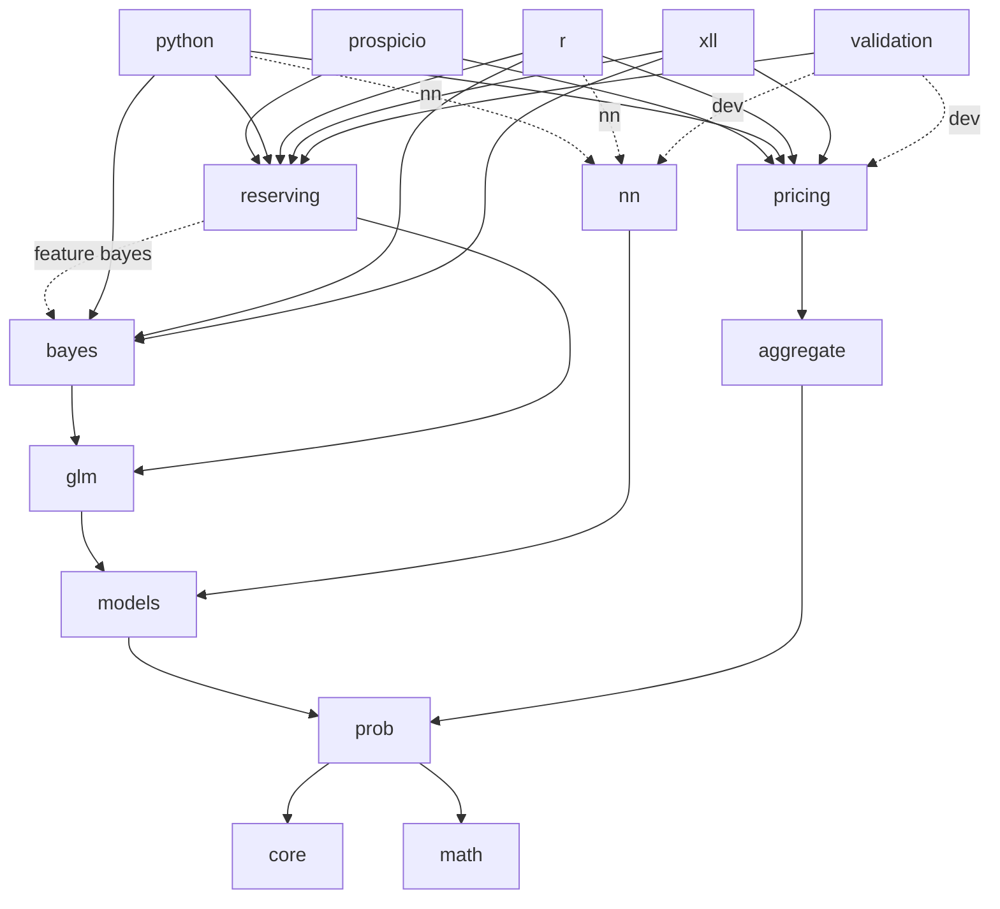
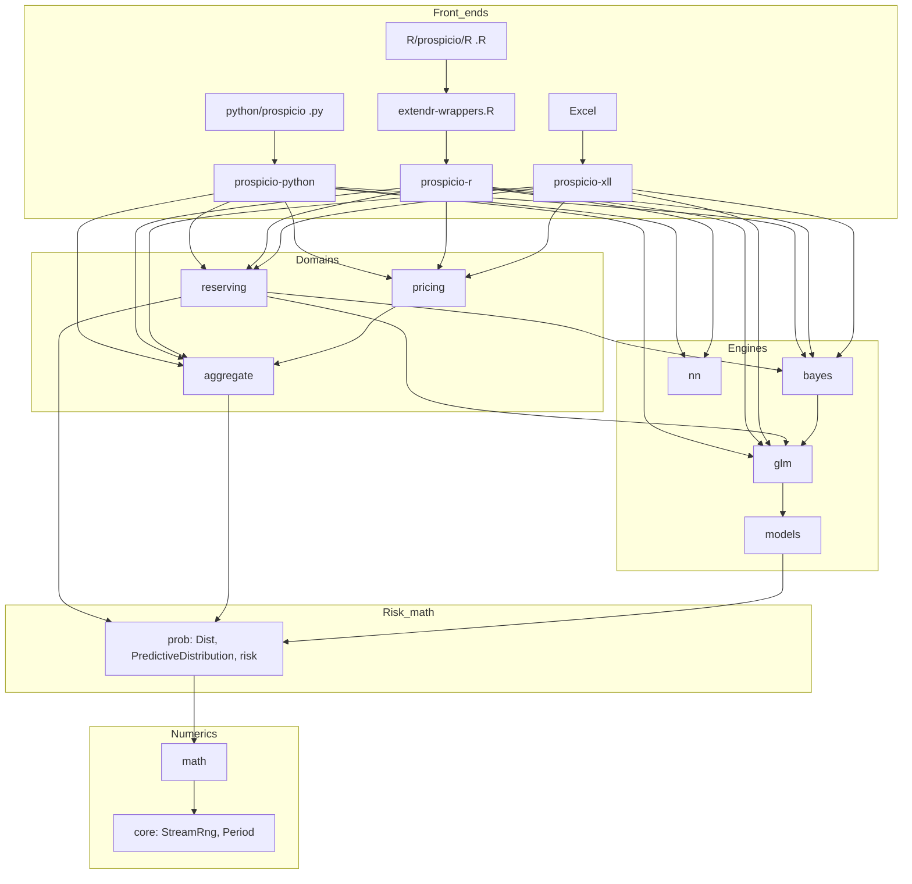
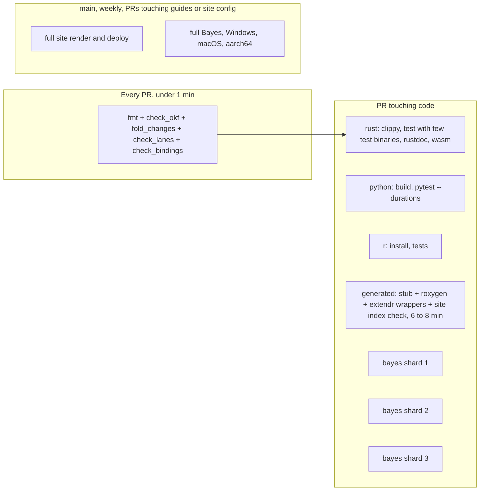

# Codebase reconnaissance: architecture, engineering efficiency and audit

Read-only audit of `EKtheSage/prospicio` at commit `1346723` (main, 2026-11-09). Nothing in the repository was changed except this file. It is written for the user and for coding agents that will act on it.

**How to read the evidence labels**

- **Measured**: a number from a command, a build, or the GitHub Actions API, run during this audit.
- **Confirmed**: the code was read and the statement follows from it. Nothing was executed to reproduce it.
- **Suspected**: plausible from the code; the check that would confirm it is named.
- Paths are relative to the repository root. `R/…` paths are the R package, not a crate.

**What was and was not run**

| Ran | Did not run |
|---|---|
| `cargo build --timings --locked` (clean, debug, default members) | `cargo test`, clippy, pytest, the R tests |
| `validation/scripts/check_bindings.py` (read-only) | Any build of the Python or R bindings |
| GitHub Actions API: all 1,979 `ci.yml` runs with 12,998 job records, 414 `pages.yml`, 100 `xll.yml`, 23 `release.yml` runs, and step logs of 140 jobs | Anything on Windows or macOS |
| `git log` over the full history (1,313 commits) | Benchmarks, coverage, clone-detection tools |

A local `cargo test --no-run --timings` was attempted and ran out of this container's disk allowance after 310 s, so test-build numbers below come from CI logs.

---

## 1. Executive assessment

**What it is.** An actuarial modeling library: a Rust core (10 library crates, about 180,000 lines) for reserving, probability and risk, aggregate loss and reinsurance, pricing, GLMs, Bayesian models and small neural networks, with three front ends: Python (PyO3), R (extendr) and an Excel add-in (XLL). A parity suite checks results against reference packages (R ChainLadder, chainladder-python, `aggregate`, statsmodels, Stan, mgcv and others).

**How it was built.** 1,313 squash commits in 44 days (2026-09-27 to 2026-11-09), mostly by coding agents working in parallel "lanes" under rules in `AGENTS.md`. Rust grew from 38,000 to 347,000 lines in five weeks.

**Engineering maturity.** High for its age in the core, uneven at the edges.

| Strengths (keep) | Weaknesses (act) |
|---|---|
| One kernel per method: every reserving entry point reaches one `fit_segment`; every simulated tower path reaches one `year_by_event` | CI wall time for a pull request grew from 4.6 to 32 minutes (weekly median); the docs job and the Bayesian job are the critical path |
| Reproducibility by design: one RNG stream per simulation index, no parallel float reductions, `total_cmp` everywhere | Three front ends each own their string vocabulary and defaults; they have already diverged |
| Parity suite: 46,703 reference rows with a tolerance per row | Model tooling (explanations, boosting statistics) is implemented once per language with no Rust kernel, against the stated architecture |
| Hard numerics exist once (`prospicio-math`: factorisations, special functions, Nelder-Mead) | Small numerics are re-written per file (13 bisections, 6 type-7 quantiles, 8 shuffles) |
| CI is already path-gated and cached (rust job starts warm on 96 to 97% of PR runs) | 105 test binaries make a warm `cargo test` 76% compilation |
| No unused dependency, no circular dependency, no dead-code backlog | Agent context: `AGENTS.md` plus lane files are 189 KB, loaded by every session |

**Greatest opportunities**, in order of value: (1) stop rendering both docs sites on every bindings PR; (2) cut test-binary link time and shard the Bayesian job; (3) give the core enums one string vocabulary used by all front ends and generate `extendr-wrappers.R`; (4) fix five small confirmed correctness defects; (5) add refactor guards that run on Linux before consolidating Bayesian scaffolding.

No Critical or High severity defect was found. The largest risks are silent divergence between front ends and slow feedback, not wrong core numerics.

---

## 2. Repository and architecture map

### 2.1 Layout and size (Measured, tracked files)

| Path | Role | Files | Lines | Notes |
|---|---|---|---|---|
| `crates/prospicio-core` | `StreamRng`, `Period`/`Lag`/`Grain`, base `Error` | 4 | 458 | Fan-out 13 crates |
| `crates/prospicio-math` | linalg, roots, optimise, quadrature, special functions, Sobol, MVN cdf, B-splines | 10 | 3,652 | `libm` only |
| `crates/prospicio-prob` | distributions, `PredictiveDistribution`, risk measures, distortions, copulas and vines, EVT, severity fits | 49 | 28,150 | The hub; optional `arrow` |
| `crates/prospicio-models` | `Design`/`Terms`, families and links, metrics, resampling, conformal, calibration, artifact envelope | 15 | 6,323 | |
| `crates/prospicio-glm` | GLM, GAM, elastic net, GLMM, double GLM, zero-inflated, quantile, MARS | 17 | 12,176 | |
| `crates/prospicio-bayes` | NUTS driver over `nuts-rs`, diagnostics, PSIS/ELPD, Bayesian GLM/GLMM, credibility, stacking | 9 | 6,345 | |
| `crates/prospicio-nn` | CANN, attention CANN, tabular nets (Burn), ONNX import | 6 | 4,679 | Pulls 120 + 10 crates |
| `crates/prospicio-aggregate` | compound distributions (FFT, Panjer), event sets, `Layer`/`Tower`, P&L ledger, cat inputs, ruin | 35 | 26,462 | 19,362 non-test |
| `crates/prospicio-pricing` | risk loads, exposure curves, credibility, ratemaking, cash-flow engine, deal book | 22 | 21,320 | 16,127 non-test |
| `crates/prospicio-reserving` | `Triangle`, chain ladder, Mack, bootstraps, expected-loss family, one-year views, Bayesian reserving (`bayes/`) | 67 | 70,933 | 44,362 non-test; `bayes/` is 18,324 of them |
| `crates/prospicio` | umbrella re-export | 1 | 34 | |
| `crates/prospicio-python` | PyO3 extension `prospicio_native` | 29 | 62,229 | 41.7% doc comments |
| `crates/prospicio-r` | extendr static library | 25 | 25,751 | |
| `crates/prospicio-xll` | Excel add-in, 143 worksheet functions | 85 | 32,226 | 17,642 src, 14,584 tests |
| `validation/` | parity tests (68 files), reference CSVs (136, 7 MB), generator scripts (167), CI check scripts | 425 | 45,334 Rust + 21,142 scripts | |
| `python/` | package (`.py` 3,658 lines), tests (20,634), generated stub (40,824) | 66 | | |
| `R/prospicio/` | hand-written R (28,094, of which 14,423 roxygen), `extendr-wrappers.R` (4,610), tests (12,592), 392 generated `.Rd` | 479 | | |
| `docs/` | architecture, roadmap, 21 design notes (25,277 lines), 44 guides with 34 R twins, lane status | 112 | 84,113 | |
| `knowledge/`, `changes/` | knowledge bundle (OKF), change fragments | 270 | 18,806 | |
| `xtask/` | docs, bindings and XLL build tasks | 1 | 1,259 | |

Rust total: 347,331 lines in 444 files. Central: `core`, `math`, `prob`, `reserving`, `aggregate`. Peripheral: `nn`, `xll`, guides.

### 2.2 Crate dependency graph (Confirmed from the manifests)



The graph is transitively reduced; every crate also names `core`, `math` and `prob` directly. There is no cycle. `pricing` does not depend on `reserving` and must not: that boundary is deliberate.

Rebuild fan-out when a crate changes (workspace crates rebuilt, of 16): `core`, `math` 13; `prob` 12; `models` 9; `glm` 7; `bayes`, `aggregate` 6; `pricing`, `reserving` 5; `nn` 4.

### 2.3 Layers as built against layers as designed



| `docs/architecture.md` says | As built | Verdict |
|---|---|---|
| "Front ends: thin wrappers only: no algorithms live here" | True for the two Rust binding crates (18 lines with arithmetic in 62,000). False for `python/prospicio/models.py`, `boosting.py` and their R twins (section 5) | Emerged organically; partly intended (duck-typed engines) |
| "Domain crates never implement their own numerics" | Hard numerics: true. Small numerics: false (section 5.2) | Drifted |
| "Linear algebra (faer)" | No workspace crate uses faer. `math/linalg.rs` (288 lines) is hand-written. faer is compiled anyway through `nuts-rs` (114 s of build) | Document as decided, or stale |
| "~5 crates at start" | 14 crates; the split follows dependency weight and is sound | Fine |
| "Bit-identical regardless of thread count" | Holds (25 parallel sites audited). Not bit-identical across platforms: `exp`/`ln` come from the platform libm (`bayes/odp.rs:2414`) | Holds, with a platform caveat the doc does not state |
| "Zero-copy via Arrow and NumPy buffers" | Python extracts `Vec<f64>` element by element and returns lists; no `numpy` crate. Arrow exists only as a Rust API | Not built |

### 2.4 Load-bearing contracts and invariants

| Contract | Where | Guarded by |
|---|---|---|
| RNG output for `(seed, stream)` is stable; one stream per simulation index | `crates/prospicio-core/src/rng.rs:28`, `docs/design/rng.md`; `rand_chacha` pinned `=0.10.0` | doctest; seed-pinned tests (Windows hashes, ignored in CI) |
| Every model returns a joint `PredictiveDistribution` with provenance | `crates/prospicio-prob/src/predictive.rs`, `provenance.rs` | `validation/tests/predictive.rs`, one golden Arrow file |
| One projection kernel per reserving method | `chain_ladder.rs:224`, `expected_loss.rs:684`, `development.rs:273` | `validation/tests/reserving*.rs` |
| One per-occurrence function and one simulation funnel for towers | `reinsurance/layer.rs:1405`, `reinsurance/tower.rs:315` | `reinsurance/tests.rs` (50), about 11,900 parity rows |
| JSON artifacts carry `format_version`; readers reject newer versions | `aggregate/src/serial.rs:174`, `models/src/artifact.rs:32`, `prob/src/serial.rs:82` | round-trip tests only; no frozen old files |
| WASM scope builds without threads, files or C | `ci.yml` rust job, last step | `cargo check --target wasm32-unknown-unknown` |
| Every public Rust item is bound in Python and R or allow-listed | `validation/scripts/check_bindings.py` | CI; 930 items, 78% Python, 72% R, 29% Excel |
| A Bayesian reserving model implements `YearModel` and passes conformance | `reserving/src/bayes/one_year.rs:282` | conformance suite (smoke on PRs, full weekly) |

---

## 3. Critical execution paths

### 3.1 Mack fit from Python

| Step | Location |
|---|---|
| Entry: `prospicio.reserving.Mack(...)` re-exported from the native module | `python/prospicio/reserving.py:23` |
| Argument parsing: strings to enums, pattern, tail | `crates/prospicio-python/src/reserving.rs:4165-4222` (`development()`, `tail_arg`, `selected_pattern`) |
| Binding-side composition: pattern converted to the origin basis at fit time | `reserving.rs:4351` (`resolved`) |
| GIL released, core called | `reserving.rs:4338` (`py.detach(|| mack.fit_segments(..))`) |
| Per-segment loop | `crates/prospicio-reserving/src/mack.rs:115` → `segments.rs:155` (`fit_each`) |
| Mack's variance on top of the chain ladder | `mack.rs:119` → `chain_ladder.rs:224` → `development.rs:273` |
| Validation | zero denominators `development.rs:370`; infinite values `triangle.rs:216`; geometric average rejected `mack.rs:120` |
| Output | `MackFit` → `SegmentFits::to_long` (`segments.rs:323`) → `FitTable` → `to_frame()` |
| Errors | `reserving::Error` → `err` → `ValueError` or `NotSupportedError` (`reserving.rs:81`) |
| Tests | unit tests in `mack.rs`; `validation/tests/reserving.rs:100,106`; `python/tests/test_reserving.py:90`; `R/prospicio/tests/test-reserving.R:62` |

### 3.2 ODP bootstrap to a risk measure

| Step | Location |
|---|---|
| Entry | `crates/prospicio-reserving/src/bootstrap.rs:503` (`OdpBootstrap::fit`) |
| Base fit through the shared kernel | `bootstrap.rs:1005` → `chain_ladder.rs:224` |
| Simulation, one stream per index | `bootstrap.rs:915` (`simulate_lifetime`) → `PredictiveDistribution::simulate`; `StreamRng::new(seed, i)` at `bootstrap.rs:1368` |
| Resampled pseudo-factors (a hot loop, deliberately separate from `Development`) | `bootstrap.rs:1187-1198` |
| Provenance with an input hash (BLAKE3) | `bootstrap.rs:713` |
| VaR and TVaR on the joint draws | `crates/prospicio-prob/src/risk.rs` via `Sampled` |
| Invariant | same result for any thread count; replay of one simulation from `(seed, i)` |
| Tests | `validation/tests/reserving.rs:143` (R `BootChainLadder` targets); `test_reserving.py:924`; `test-reserving.R:595` |

### 3.3 Simulated events through a tower to an investor return

| Step | Location |
|---|---|
| Events | `crates/prospicio-aggregate/src/monte_carlo.rs` (`EventSet`) |
| Tower applied | `reinsurance/tower.rs:507` (`apply`) → `:901` (`push_year`) → `:315` (`year_by_event`) |
| Per occurrence, then annual terms | `reinsurance/layer.rs:1405` (`recovery_at`), `:1435` (`recoveries`), `:1463` (`after_terms`) |
| Deal amounts and ratios | `deal.rs:702` (`deal_amounts`) |
| Cash flows per simulation | `crates/prospicio-pricing/src/cashflow.rs:1064` (`simulate`) |
| IRR | `pricing/src/returns.rs:349` (bisect, then Newton; `found: false` when no root) |
| Same contract on a grid (a distribution transform, separate by necessity) | `grid_reinsurance.rs:308` (`on_grid`), sharing `recovery` and `after_terms` |
| Tests | `reinsurance/tests.rs` incl. `gross_equals_ceded_plus_net_every_year`; `validation/tests/aggregate.rs:2243` (`aggregate` 2.1.0) |

```mermaid
sequenceDiagram
  participant U as Python or R or Excel
  participant B as binding crate
  participant D as domain crate
  participant P as prob
  U->>B: strings, lists, objects
  B->>B: parse to core enums (per front end)
  B->>D: settings struct + Triangle or EventSet
  D->>P: PredictiveDistribution::simulate(seed, n)
  P-->>D: joint draws + provenance
  D-->>B: fit struct, FitTable
  B-->>U: lists, dicts, data frames; Error -> ValueError or R condition
```

---

## 4. Codebase complexity assessment

### 4.1 Growth (Measured, lines in tracked files at each date)

| Date | Rust | of which bindings | xll | validation | Python | R | md + qmd | Commits |
|---|---|---|---|---|---|---|---|---|
| 10-04 | 38,356 | 10,457 | 0 | 1,729 | 3,435 | 5,984 | 2,471 | 222 |
| 10-11 | 83,263 | 23,800 | 0 | 6,359 | 8,692 | 14,014 | 8,292 | 507 |
| 10-18 | 170,559 | 45,646 | 9,570 | 17,328 | 20,549 | 24,923 | 63,026 | 985 |
| 10-25 | 255,816 | 67,410 | 18,365 | 31,588 | 30,124 | 37,076 | 86,003 | 1,163 |
| 11-01 | 300,997 | 77,507 | 24,087 | 36,468 | 37,046 | 42,696 | 94,337 | 1,243 |
| 11-09 | 347,331 | 87,980 | 32,226 | 45,334 | 42,455 | 49,713 | 109,810 | 1,313 |

Growth is feature-driven, not legacy: there is no deprecated code and little dead code. About half of all Rust is front end plus parity tests.

### 4.2 Where the lines are

- **File sizes (Rust):** 228 files under 500 lines, 110 of 500 to 999, 79 of 1,000 to 1,999, 22 of 2,000 to 3,999, 5 over 4,000.
- **Largest file:** `crates/prospicio-python/src/reserving.rs`, 21,793 lines (784 getters, 274 other methods, 40% doc comments). Issue #579 split core files over about 1,500 lines; the binding files were not split.
- **Function length:** median 8 to 9 lines in the three domain crates. Functions of 100 lines or more: reserving 30, aggregate 16, pricing 7. Longest: `Ledger::new` 453 (`aggregate/src/pnl.rs:943`), `Hachemeister::fit` 331 (`pricing/src/credibility.rs:615`), `layer_from` 285 (`aggregate/src/serial.rs:464`).
- **Configuration surface:** `Layer` has 27 public fields (`reinsurance/layer.rs:31`). `reserving::Error` has 52 variants, 13 of them `Foo(String)`.
- **Cargo features:** few and purposeful (`bayes`, `io`, `parallel`, `slow-tests`, `arrow`, `onnx`, `nn`).

### 4.3 Abstractions: do they earn their place?

| Abstraction | Implementors | Verdict |
|---|---|---|
| `ReserveFit` + `SegmentFits<T>` (`reserving/src/segments.rs:223`) | 15+ | Earns it: one table rule for every method |
| `YearModel` (`bayes/one_year.rs:282`) | 4 (one serves 3 models through `OdpCells`) | Earns it: engine 252 + 390 lines shared, impls hold only model arithmetic |
| `Posterior` (`bayes/laplace.rs:23`) | 7 | Earns it |
| `TriangleModel` (`backtest.rs:49`) | 5 | Earns it |
| `Dual<N>` + `Scalar` (`bayes/dual.rs`, `scalar.rs`) | N = 2, 4, 5, 32 | Earns it; a second one-tangent dual exists in `prospicio-bayes/src/credibility.rs:879` |

No trait with a single implementor and no generic parameter with a single instantiation was found. Over-engineering is not this codebase's problem. Missing small shared helpers is.

### 4.4 Change propagation (Measured, 133 commits since 10-20 that touch a core crate)

- Median commit: **20 files, 11 kinds of file, 1,311 lines**; 90th percentile 33 files.
- Share of changed lines: core 38%, validation 27% (reference CSVs included), Python binding 8%, generated Python stub about 5%, R wrappers 4%, R binding 3.5%, design docs 3%, generated R `man/` 3%, tests 4.5%, knowledge and change fragments 2.6%.
- 108 of 133 touched both binding crates. 122 touched knowledge or change fragments. 117 touched design docs or the roadmap.
- Most-changed files in the whole history: `prospicio_native.pyi` (244 commits), `docs/roadmap.md` (238), `extendr-wrappers.R` (206), `AGENTS.md` (206), `NAMESPACE` (176), `_pkgdown.yml` (169), `great-docs.yml` (110). Four of the seven are generated or index files.

A new public function is written or described in up to nine places: core, Python Rust wrapper with docstring, R Rust wrapper, `extendr-wrappers.R` (by hand), R wrapper with roxygen, stub, `man/`, the two site indexes, plus lane, roadmap, design note and fragments.

### 4.5 Simplification opportunities with supported size estimates

| Opportunity | Estimated reduction | Basis |
|---|---|---|
| Core-owned `from_name`/`as_str` for enums, used by three front ends | about 800 match arms (281 Python + 386 R + 123 to 215 XLL) | counted |
| Shared `psis_loo`, two sampler drivers, BF and BFN common code | 600 to 700 of about 2,000 parallel lines in `bayes/` | line-run matching: 359 of `bf.rs`'s 605 code lines recur in `bf_normalised.rs` |
| Small numeric helpers into `math`/`prob` | 400 to 600 lines | 13 bisections (about 200), glue linalg (about 250), quantile, rank, shuffle copies |
| Compositions out of both binding crates | about 250 lines, and one behaviour instead of two | `underwriting_paid` is 48 identical lines twice |
| Test helpers (`near` in 38 R files, no `conftest.py`) | several hundred test lines | counted |

None of these changes run time. Their value is one behaviour instead of several.

---

## 5. Duplication and responsibility overlap matrix

### 5.1 Architectural duplication (highest value)

| Modules | Overlap | Evidence | Semantic differences | Recommendation | Risk |
|---|---|---|---|---|---|
| Python, R and XLL argument parsers | Three string vocabularies for the same core enums; no `FromStr` in the core except three `from_name` (`prob/src/severity_fit.rs:53`, `grouped_fit.rs:199`, `aggregate/src/pml.rs:121`) | Confirmed | Count distribution: Python `negative_binomial` only (`prospicio-python/src/models.rs:6014`), R `negbin` only (`prospicio-r/src/models.rs:2821`), XLL both. `log-linear`: R uses three spellings in three functions (`prospicio-r/src/reserving.rs:230, 2628, 2764`). Grain: Python case-insensitive, R exact. Mixing alias `ig`: Python only. Pattern kind: XLL `percent`, others `percent_developed`. R `match.arg` accepts partial matches | `from_name` + `name` on each core enum; front ends call it. Accept every existing spelling | Low; error texts change, and both test suites assert texts |
| XLL GLM against Python and R GLM | Default link | Confirmed: XLL defaults to log (`prospicio-xll/src/glm.rs:276`); Python and R use `canonical_link()` (`prospicio-models/src/family.rs:78`): gamma → inverse | The same family with no link fits a different model in Excel. XLL's help text states its rule | A user decision: align, or state the difference in all three helps | Changing a default is breaking |
| `python/prospicio/models.py:843-1778` and `R/prospicio/R/models.R:1628-1999` | Permutation importance, PD, ICE, ALE, SHAP: two implementations, no Rust kernel | Confirmed | Python hand-codes R's quantile types and classical scaling by power iteration (`models.py:1474`); R calls `stats::cmdscale` (`models.R:1866`). Suspected: they order ALE factor levels differently when the distance matrix has a dominant negative eigenvalue | Move ALE binning and ordering, Shapley weights and quantile types into `prospicio-models` over prediction vectors; keep the `predict` callback per language. First add a cross-language parity test | Medium |
| `python/prospicio/boosting.py` (609) and `R/prospicio/R/boosting.R` (542) | Base score, Pearson dispersion, cross-fitted dispersion head, bootstrap refits | Confirmed | R's dispersion booster inherits the mean model's monotone and interaction constraints (`boosting.R:93`, `dspec <- spec`); Python's does not (`boosting.py:286`). Bootstrap rows and folds use each language's RNG, so results differ between languages | Decide the constraint rule once; draw rows and folds from the Rust resampler | Medium: a silent difference today |
| Both Rust binding crates | Compositions that need two crates | Confirmed: `underwriting_paid` identical at `prospicio-python/src/payout.rs:136-183` and `prospicio-r/src/pricing.rs:1580-1628`; `stack_programs` (`prospicio-python/src/reserving.rs:13462`, `R/prospicio/R/reserving.R:4495`); HierarchicalBf tables in the bindings | R rejects a column named `program`; Python does not | Add `Triangle::stack` and HierarchicalBf `to_long` to reserving; give the pattern join one Rust home that sees both crates | Low |
| `reserving::SelectedPattern` and `pricing::PaymentPattern` | Two models of a development pattern | Confirmed | Earning: reserving writes evenly through the month (`reserving/src/pattern.rs:1094`, weights `1/2m, 1/m, …, 1/2m`); pricing writes at the start of the month (`pricing/src/cashflow.rs:72`). "Log-linear": reserving interpolates `ln` of the factor (`pattern.rs:1196`), pricing the unpaid share (`payout.rs:247`). A deal that goes through both mixes two conventions | Keep both types. Name the two readings differently and document or align the earning convention: a user decision | Aligning changes printed numbers |
| R wrappers that recompute core results | `limited_fluctuation_credibility` (`R/prospicio/R/credibility.R:35`), `worst_var` grid (`risk.R:1299`), Hachemeister `predict` (`credibility.R:167`) | Confirmed | NaN `n` gives 0 in the core and NaN in R; R skips the core's checks | Call the core | Low |
| Rust `resample`, `compare`, `conformal` orchestration and their Python and R versions | Three implementations (`prospicio-models/src/resample.rs:271`, `models.py:388`, `models.R:1482`) | Confirmed | The language loops exist because boosters are duck-typed. R's `random_search` calls `set.seed` without restoring state (`models.R:1505`) | Keep; record the reason in the allow-list | None |

### 5.2 Semantic and syntactic duplication in the core

| Family | Sites | Relationship | Recommendation | Risk |
|---|---|---|---|---|
| Type-7 quantile | `prob/src/risk.rs:81` (checks inputs) and five unchecked copies: `reserving/src/backtest.rs:657`, `glm/src/quantile.rs:105`, `bayes/src/nuts.rs:674`, `bayes/src/lib.rs:271`, `bayes/src/ppc.rs:71` | Same arithmetic | One function in `prob` | Bit-safe |
| Average ranks, Pearson | `prob/src/portfolio.rs:576, 596`; `reserving/src/assumptions.rs:344, 365`; `bayes/src/lib.rs:141` | Same result | One in `prob` | Bit-safe |
| Fisher-Yates shuffle | 8 identical bodies: `prob/src/copula.rs:1058`, `rearrangement.rs:84`, `reserving/src/dependence.rs:457`, `models/src/resample.rs:462`, `nn/src/lib.rs:261, 281`, `nn/src/tabular.rs:622, 643` | Textual copies | A method on `StreamRng` | Bit-safe (same body) |
| Bisection | `math::bisect`, `bisect_log`, `illinois` (25 call sites) and 13 hand-written loops with 8 different stop rules (for example `prob/src/capital.rs:408`, `pricing/src/quote.rs:464`, `reserving/src/tail.rs:508`) | Different tolerances | Add a fallible `try_bisect`; migrate one site per PR | Last-bit changes against 1e-9 to 1e-12 pins |
| Damped Newton with ridge repair | `reserving/src/bayes/laplace.rs:84, 152`, `glm/src/zero.rs:516`, `models/src/stack.rs:166`, `glm/src/glmm.rs:1311` | Different ridge ladders and stops | Leave until a Linux refactor guard exists | Highest parity risk |
| Finite-difference Hessians | 5 sites, 3 step rules (`prob/src/severity_fit.rs:375`, `aggregate/src/hawkes.rs:397`, `glm/src/glmm.rs:1275`, `laplace.rs:36`, `glm/src/zero.rs:488`) | Different | `math::diff`, low priority | Standard errors move in late digits |
| Matrix multiply, inverse, log-det | `pricing/src/credibility.rs:556`, `reserving/src/bayes/moment_match.rs:376`, `glm/src/robust.rs:162`; inverse at `reserving/src/clark.rs:606`, `prob/src/severity_fit.rs:400`, `grouped_fit.rs:438` | Glue around `math::linalg` | Add `mat_mul`, `inverse`, `cholesky_log_det` | Low |
| Least-squares line | `reserving/src/curve.rs:377`, `frequency_severity.rs:207, 258`, `development.rs:486`, `pricing/src/ratemaking.rs:520`, `models/src/monitor.rs:161`; two public types both named `TrendFit` | Mostly the same | One helper in `math` | Low |
| PSIS-LOO with `r_eff` | 5 near-identical blocks of about 45 lines: `bayes/odp.rs:1354`, `bf.rs:536`, `bf_normalised.rs:896`, `meyers.rs:1038`, `compartmental/results.rs:485` | Copies | One `psis_loo(log_lik, chains)` | Needs a pinned `elpd` test per model first |
| NUTS `sample` drivers | 6 copies in two flavours; BF and BFN bodies identical (`bf.rs:355`, `bf_normalised.rs:472`) | Copies | `sample_at_mode`, `sample_with_pilot` | Needs same-seed replay tests on Linux |
| JSON float and envelope helpers | `prob/src/serial.rs:335-389` and `aggregate/src/serial.rs:750-790` are textual copies; `models/src/artifact.rs` has a third set | Models rejects `format_version` 0; the other two accept it | Share one set (prob sits below both) | Low |
| Plain XoL formula, surplus share, reinstatement schedule | `aggregate/src/layer_statistics.rs:112`, `collective.rs:149`, `pricing/src/frontier.rs:290`, `ils.rs:271`; surplus share at `reinsurance/terms.rs:267` and `pricing/src/profile.rs:488` | One-liners | Leave the one-liners; share the two formulas | None |
| Three `Layer` constructors with opposite argument order | `reserving::excess::Layer::new(attachment, limit)` (`excess.rs:58`), `pricing::XsLayer::new(limit, attachment)` (`layer.rs:29`), `aggregate::Layer::xol(name, limit, attachment)` (`layer.rs:115`) | An API hazard, not duplicate logic | Document; consider named constructors | Breaking if changed |

### 5.3 Looks duplicated, keep separate

| Item | Reason |
|---|---|
| Bootstrap pseudo-factor loops (`bootstrap.rs:1187`, `mack_bootstrap.rs:567`) against `Development` | Resampling hot paths, not estimation |
| Hand-written gradients beside generic densities (ODP, BF, BFN, Meyers) | Fast path plus a test oracle |
| `on_grid` against `year_by_event` | A distribution transform against a simulation; they share the layer primitives |
| `PaymentPattern` against `SelectedPattern` as types | `pricing` must not depend on `reserving` |
| Six quantile conventions (three in `prob`, conformal rank, R's median, loo's quartile) | Each matches a reference |
| Three credibility modules; four growth-curve fits; QP, LP and active-set solvers | Different problems |
| Semidefinite Cholesky (`monthly_reading.rs:554`), null-space row reduction (`pricing/src/tower.rs:935`) | Different contracts from `math::cholesky` |
| `fit_segments` per Bayesian model | Draw layouts differ |
| Parity re-asserted from Python and R | The 88,000 lines of binding Rust have zero Rust tests; these are their only tests |

---

## 6. CI/CD performance assessment

All numbers in this section are Measured from the Actions API unless marked.

### 6.1 Structure

| Workflow | Trigger | Jobs |
|---|---|---|
| `ci.yml` | PR, push to main, weekly, manual | `rust` (always), `python`, `r` (skip docs-only PRs), `docs` (PRs touching bindings, `python/`, `R/`, `xtask/`), `bayes`, `fremtpl2`, `deny`, `deal-report` (path-gated), `examples-r` (weekly) |
| `pages.yml` | push to main touching crates, bindings, guides | full docs build and deploy |
| `xll.yml` | PR and push touching 9 crates; tags | cross-build the add-in, smoke test under Wine |
| `release.yml` | tag or manual | 4 wheel jobs with the full pytest each, sdist, crates dry run, semver-checks, publish |

### 6.2 Baselines

**Run level (all 1,979 `ci.yml` runs).**

| Event | n | Success | Failed | Cancelled | Median (ok) | p95 (ok) |
|---|---|---|---|---|---|---|
| pull_request | 1,347 | 65.9% | 7.6% | 26.4% | 13.1 min | 32.0 min |
| push | 622 | 84.1% | 2.4% | 13.5% | 7.9 min | 14.3 min |

**Trend: successful PR runs by ISO week.**

| Week | W40 | W41 | W42 | W43 | W44 | W45 | W46 (2 days) |
|---|---|---|---|---|---|---|---|
| Median, min | 4.6 | 9.4 | 12.0 | 21.6 | 23.5 | 22.3 | 32.2 |
| p95, min | 7.6 | 14.3 | 18.7 | 32.0 | 32.6 | 39.1 | 44.7 |

**Successful PR runs since 11-03 (n = 129), by what ran beside `rust`.**

| Jobs that ran | n | Wall median | Wall max |
|---|---|---|---|
| bayes + docs + python + r | 51 | 30.1 | 45.6 |
| rust only | 34 | 10.2 | 17.4 |
| docs + python + r | 19 | 26.3 | 61.0 |
| python + r | 12 | 15.4 | 19.4 |
| bayes + python + r | 11 | 32.0 | 39.1 |

- Last job to finish since 11-03: `bayes` 35%, `rust` 29% (the rust-only runs), `docs` 26%, `python` 5%, `r` 4%.
- Runner-minutes per successful PR run since 11-03: median 70.7, p95 107.6.
- Total job-minutes over the project: 53,064 (884 hours): rust 26%, docs 22%, r 16.5%, bayes 16%, python 15%, Windows 2.6%.
- Cancelled PR runs consumed 8.3% of job-minutes; failed PR runs 7.9%.
- Runs per day: median 45, maximum 144.
- Re-runs: 10 of 1,979 (0.5%). Queue time: median 2 s.
- Weekly full run (11-09): 217 minutes wall, of which the Bayesian parity tests are 211.

**Step level (ranges over 23 recent PR runs, seconds).**

| Job | Step | Range |
|---|---|---|
| rust | `cargo test` | 434 to 593 |
| python | `uv sync` (builds the extension) | 122 to 223 |
| python | pytest | 499 to 927 |
| r | `R CMD INSTALL` | 116 to 178 |
| r | R tests | 385 to 691 |
| docs | `cargo xtask docs --check --no-tests` | 1,105 to 1,857 |
| bayes | parity tests | 1,080 to 2,295 |

Hosted runners come at three discrete speeds: identical pytest runs took 503, 768 and 926 s on the same image. Any before-and-after comparison must use medians over many runs or a speed proxy.

### 6.3 Bottlenecks, with their evidence

**B1. The docs job renders both sites on every bindings PR, only to check three generated paths.** `cargo xtask docs --check --no-tests` (`xtask/src/main.rs:913`) runs rustdoc, builds the Python extension, executes the notebooks, renders the Python site, runs roxygen, installs the R package, renders the pkgdown site, and only then runs `unchanged(PYTHON_GENERATED)` and `unchanged(R_GENERATED)` (`main.rs:138`, `:597`). Phase split of one 30m57s step (run 42697722420, a slow runner):

| Phase | Time | Needed for the staleness check |
|---|---|---|
| python: sync the environment (builds the extension, makes the stub) | 3m15s | Yes |
| python: stage guides, execute notebooks | 1m19s | No |
| python: render the docs site (executes 38 guides) | 13m02s | No |
| r: roxygen (2m38s is the Rust release compile) | 2m53s | Yes |
| r: render the docs site (pkgdown, executes 31 articles) | 9m52s | No |
| rustdoc, R install, `undoc`/`codoc`, collect | under 1 min | Partly |

About 24 of 31 minutes are site rendering. The same full build runs again on main in `pages.yml` (median 23.7 min), and the PR's uploaded `docs-site` artifact has no consumer. Because a new public item must be bound in the same PR, most feature PRs trigger this job: it ran in 70 of the 129 successful PR runs since 11-03. The step has grown from 1.9 min (10-02) to 25.2 min (11-09); PR #809 (guides executed on the sites) added about 26% at matched runner speed.

**B2. A warm `cargo test` is 76% compilation.** In run 42697722420 the cache was a full match, and the 465 s step was: 355 s to "Finished `test` profile", 87 s running 105 test binaries, 21 s of doctests. Library crates finished compiling 72 s in; the remaining 284 s compiled and linked the integration-test binaries of `validation` (41 ungated files in `validation/tests/`, each its own binary) and `prospicio-xll` (49 files in `crates/prospicio-xll/tests/`). Each binary links the whole dependency tree with full debug info.

**B3. The Bayesian job is 27 to 35 minutes on a PR and is the last job in 35% of runs.** Per-binary run times in one PR job (run 42652474502, 28.9 minutes of tests):

| Test binary | Time | Share |
|---|---|---|
| `reserving_compartmental_one_year` | 414 s | 23.9% |
| `reserving_bayes_hierarchical_bf` | 392 s | 22.6% |
| `reserving_bayes_one_year_conformance` | 155 s | 8.9% |
| `reserving_compartmental_gm2` | 146 s | 8.4% |
| `prospicio-reserving` unit tests (`slow-tests`) | 128 s | 7.4% |
| 23 others | 497 s | 28.8% |

The binaries run one after another. The job's path filter includes all of `crates/prospicio-prob/` and `-math/`, so a change to a distortion triggers it (that run's PR added Tweedie parameter conversions).

**B4. pytest rose by a factor of about 1.45 between 11-06 and 11-08** (slow-runner cluster 10.4 → 15.3 min) with no identified cause; it predates the guides' figures. The Python job median is now 19 to 20 minutes. CI does not print test durations, so the cause cannot be read from the logs.

**B5. Failures cluster in the docs job.** Of 80 real PR failures, 46 were in `docs`: 21 "generated docs are out of date", 11 pkgdown index errors (a new export missing from `_pkgdown.yml`), the rest build errors. The failing step ran 8 to 20 minutes before failing. `cargo fmt` never failed a run. 35 other failed runs were billing failures where no job started.

**B6. Smaller items.**

- The `rust` job has no path gate. A lanes-only or knowledge-only PR still runs clippy and `cargo test` (10 minutes); the three fast Python checks it actually needs take 5 s.
- `xll.yml`'s path filter omits `crates/prospicio-bayes/**` and the root `Cargo.toml`, both inputs of the add-in (`.github/workflows/xll.yml:12-22`).
- Each release builds and tests all four wheels twice (manual dry run, then the tag); the wheel jobs have no Rust cache (maturin 5 to 10 min each, wheel test 11 to 15 min each).
- `setup-r-dependencies` is usually 50 s, but exceeded 3 minutes in 20 of 776 docs jobs (up to 24 minutes) when the Ubuntu mirror was slow; it installs pandoc by apt although `xtask` already uses Quarto's pandoc.

**B7. The cost rule is stale.** `ci.yml:3` and `AGENTS.md` say the repository is private and Windows minutes are billed double, so PRs run Ubuntu only. The GitHub API reports `"private": false, "visibility": "public"`, and the timing API reports zero billable time. Platform coverage on PRs is now a choice about waiting time, not cost. Platform-only failures have been found late (aarch64 tests, macOS guide time limit at the 0.0.8 release).

### 6.4 Proposed CI architecture



1. Split `docs` into `generated` (every bindings PR) and `site` (main, weekly, and PRs that touch `docs/guides/`, `examples/`, site config or `xtask/`).
2. Move the five fast repository checks into a job of their own and path-gate the heavy part of `rust`.
3. One integration-test binary per crate for `validation` (plus one for the `slow-bayes` set) and for `prospicio-xll`.
4. Shard `bayes` by test binary into three matrix legs.
5. Add `--durations=25` to pytest and a per-file timer to the R loop.
6. Decide platform coverage now that minutes are free.

---

## 7. Dependency and coupling assessment

**Clean results (Confirmed).** No declared dependency is unused. No circular dependency. No item sits in a higher crate only to serve a lower one. `deny.toml` audits all 626 lock entries. RNG crates are pinned exactly.

**Build weight (Measured: clean debug build of default members, 4 cores, 5m47s wall, 338 units, 1,243 unit-seconds).**

| Group | Unit-seconds | Share | Used by |
|---|---|---|---|
| Workspace crates | 394 | 32% | reserving 98, aggregate 71, bayes 62, nn 42, prob 31, pricing 26, xll 23, glm 23 |
| Burn and its tree | 131 | 11% | `prospicio-nn` only |
| `onnx-ir` + protobuf (two builds) + codegen | 127 | 10% | `prospicio-nn`'s default `onnx` feature |
| faer + four `nano-gemm` kernels (through `nuts-rs`) | 114 | 9% | `prospicio-bayes` only |
| `nuts-rs` | 24 | 2% | |
| Proc-macro stack (`syn` ×3, `darling` ×2 …) | about 120 | 10% | |

- A plain `cargo test` compiles 238 external crates; 105 of them only because `prospicio-nn` (4,679 lines) is a default member. With the CI cache this cost is paid only when `Cargo.lock` or the toolchain changes (3 to 4% of rust jobs started cold).
- 13 crate names compile in two or three versions (`syn` ×3, `getrandom` ×3).

**Findings.**

| # | Finding | Evidence | Status |
|---|---|---|---|
| D1 | `rust-version = "1.85"` is declared but no CI job builds on 1.85, and default members cannot build on it: `R/prospicio/DESCRIPTION:9` says rustc ≥ 1.92 for Burn. The pin holds back arrow (59.x) and calamine (0.35), and calamine 0.35 is why 7 RustSec advisories are ignored in `deny.toml` | `Cargo.toml:29, 52, 59`; every workflow uses `dtolnay/rust-toolchain@stable` | Confirmed |
| D2 | `validation` dev-depends on `nn`, `arrow` and `calamine` for one test file each, so the release `bayes` job builds Burn and the `fremtpl2` job builds `nuts-rs` and faer | `validation/Cargo.toml`; `validation/tests/fremtpl2.rs:236`, `predictive.rs:16`, `reserving_io.rs` | Confirmed |
| D3 | `prospicio-bayes` holds the sampler (used by reserving: `nuts` 45 sites, `elpd` 14) and about 4,000 lines of Bayesian GLM, GLMM, credibility and stacking models that reserving does not use; reserving therefore rebuilds when a Bayesian GLM changes | grep of `use prospicio_bayes::` | Confirmed; a split is not yet justified by build time (62 s) |
| D4 | Never compiled in CI: bindings without `nn`; the umbrella crate's features; `prospicio-xll/src/xll.rs` (624 lines of `cfg(windows)` unsafe FFI) under clippy; the sequential branch at `reserving/src/pattern_draws.rs:247` is checked on WASM but never executed | workflows | Confirmed |
| D5 | `reserving`'s `parallel` feature exists for the WASM path, but `prob` and `aggregate` (both in the WASM scope) depend on rayon unconditionally | manifests | Suspected redundant |
| D6 | Python 3.9 to 3.11 are never tested although `requires-python >= 3.9` (abi3 wheel, tests on 3.12) | `release.yml` | Confirmed |

---

## 8. Engineering efficiency scorecard

No scores: baselines, evidence and gaps.

| Dimension | Baseline | Evidence | Inefficiency | Potential | How to measure | Confidence | Data gaps |
|---|---|---|---|---|---|---|---|
| Codebase bloat | 347k Rust lines; core 180k (about 125k non-test); front ends 120k; validation 45k | `git grep -c`; section 4.1 | 26k doc-comment lines in the Python crate and 14k roxygen lines repeat the Rust docs; 21.8k-line binding file | No large cut is justified. Section 4.5 lists about 2,500 lines of real duplicate logic | Recount after each consolidation | High | No clone-detector run |
| Duplication | 13 bisections, 6 type-7 quantiles, 8 shuffles, 5 `psis_loo` blocks, 6 sampler drivers | section 5.2 | Divergent tolerances and input checks | One behaviour per primitive | grep counts in section 5.2 fall to 1 | High for listed sites | Inline variances and 9 of 12 interpolation sites not read |
| Architectural duplication | 3 string vocabularies; 2 implementations of explanation tools and boosting statistics; 2 pattern models with different earning | section 5.1 | 7 confirmed front-end divergences | Zero divergences, enforced by a test | A table-driven test that feeds every accepted name to all three parsers | High | Defaults compared for 4 features only |
| CI/CD efficiency | PR median 26 to 32 min when docs or bayes run; 70.7 runner-min per PR run; 26% of PR runs cancelled | section 6.2 | Site render on PRs; serial Bayes; 105 test binaries | Section 9 | Actions API medians over ≥ 50 runs, by job class | High | Billable time unavailable (public repository) |
| Build performance | Clean debug build 5m47s on 4 cores; warm CI test build 355 s | `cargo --timings`; CI log | 284 s of the warm build is integration-test binaries | Section 9, H2 | "Finished `test` profile" line in the rust job log | High for the baseline | Incremental local build not measured; disk allowance stopped the local test build |
| Dependencies | 626 lock entries; 238 compiled by `cargo test`; 0 unused; 9 advisories ignored | section 7 | Untested MSRV pins old arrow and calamine | Drop 7 ignores | `cargo deny check` with the ignores removed | High | Whether locked versions build on 1.85 |
| Maintainability | Median feature commit: 20 files, 11 kinds, 1,311 lines | section 4.4 | Hand-edited `extendr-wrappers.R` (206 commits); 46 of 80 PR failures in docs, 21 of them stale generated files | Fewer hand-synchronised files | Docs-job failure share over the next 100 PR runs | High | |
| Test effectiveness | 2,381 Rust `#[test]`; 753 pytest; 49 R files; 46,703 reference rows; 0 tests in the binding crates' Rust | section 9 of the testing audit, summarised in section 10.3 | References not checked against generators; no Linux bit-exact guard for Bayesian models; R runner stops at first failure | Section 13 | Count of references with a verified generator; pins run in CI | Medium | No coverage tool; nothing executed here |
| Numerical correctness | Parity tolerances: 44% of rows at ≤ 1e-9 relative, 37% absolute | reference CSVs | Platform libm makes seeded NUTS output differ by platform | Platform-independent pins | Same hash on Linux, macOS, Windows | Medium | Not run on any platform here |
| Developer productivity | Time to green on a feature PR: 26 to 32 min median, 45 max; 189 KB of agent instructions per session; 12 manual release actions; 13 hand-bumped version strings | sections 6, 4.4; `wc -c AGENTS.md docs/lanes/*.md` | Waiting on docs and bayes; context spent on history | Section 9 | PR wall median; bytes loaded | High | Agent token cost per session not measured |

**Trend.** CI time, binding size and agent-context size are all rising monotonically. CI was cut once (PR #439 on 10-20: `cargo test` 11 → 5.4 min, docs 25 → 16 min) and both have grown back to 8.2 and 25.2 minutes.

---

## 9. Before-and-after optimization hypotheses

"Expected" values are estimates until measured after the change. Wall-time claims are made only for job classes where the job is on the critical path.

| ID | Area | Current baseline (Measured) | Proposed change | Expected outcome | Evidence | Validation | Risk and what would invalidate it |
|---|---|---|---|---|---|---|---|
| H1 | Docs job | `docs` job median 23.5 to 27.9 min (11-08, 11-09); last job in 26% of PR runs; "docs + python + r" runs: wall median 26.3 | PR job checks generated files only (stub, `man/`, `NAMESPACE`, wrappers, site indexes); render sites on main, weekly, and PRs touching guides or site config | Job 6 to 8 min. Wall for "docs + python + r" runs falls to the python job (16 to 20 min). No wall change when `bayes` runs, until H3. About 15 to 20 runner-minutes saved per docs-running PR run | Phase split: 24 of 31 min is rendering; the check needs 6 min | Median `docs` job time and wall by job class over 50 PR runs | A guide that breaks on a binding change is found on main, not on the PR. Invalid if pkgdown index errors (11 of 46 docs failures) cannot be caught by a static check; `pkgdown::check_pkgdown()` should catch them |
| H2 | Test binaries | Warm `cargo test`: 355 s compile + 108 s run; 284 s of compile is `validation` (41 binaries) and `xll` (49) | One integration-test binary per crate (`tests/main.rs` with modules; `slow-bayes` set as a second binary) | Compile 355 s → 130 to 200 s; rust job 9.5 → 6 to 7 min; rust-only PRs (26% of runs) finish that much sooner | Timeline in the job log; each binary links the full tree with debug info | "Finished `test` profile" over 20 runs before and after; run a local A/B first | Tests that rely on process isolation or env vars (`RISK_RS_*`) may interact; `--test <name>` filters in docs and `ci.yml`'s `bayes` job must change. Invalid if codegen, not linking, dominates |
| H3 | Bayes job | 27 to 35 min on PRs; last job in 35% of runs; two binaries are 46% of test time | Matrix of 3 shards by test binary, balanced on the measured times | Job wall about 12 to 15 min; runner-minutes rise by about 2 builds (4 to 6 min). Runs with bayes: wall 30 → about 20 (then python is last) | Per-binary times in section 6.3 | Median `bayes` wall and total job-minutes over 30 runs | Improves waiting, worsens compute. Shard balance drifts as tests are added |
| H4 | Bayes trigger | Any change under `crates/prospicio-prob/` or `-math/` triggers 30 min of Bayesian tests | Keep the trigger (it is dependency-correct); revisit only with H3 done | None claimed | | | Narrowing by path would be unsound |
| H5 | pytest | 8.4 to 15.4 min; rose ×1.45 on 11-06 to 11-08, cause unknown | `--durations=25` in CI; then act on what it shows; consider `pytest-xdist` | Unknown until measured | Step history | Duration report | xdist needs tests free of shared state; guides have a per-guide time limit that parallel load could break |
| H6 | Front-end vocabulary | 7 confirmed divergences; about 800 string match arms | `from_name`/`name` on core enums; front ends call them | 0 divergences; a new enum variant needs one edit, not three | Section 5.1 | A test that iterates every variant through each front end | Error message texts change; tests assert them |
| H7 | Generated R wrappers | `extendr-wrappers.R` edited by hand in 206 commits; arity drift is caught only if a test calls the function | Generate in `cargo xtask r`, add to `R_GENERATED` | One less hand step per binding; staleness becomes a CI failure with a clear message | `knowledge/environment/local-checks.md:73` | File absent from PR diffs except by generation | Generated order differs on Windows; sort before writing |
| H8 | Agent context | `AGENTS.md` 18.7 KB + lane files 170 KB imported by every session | Keep `## Next` in the imported file; move `## Done` to a file that is not imported | About 160 KB (roughly 40,000 tokens) less per session | `wc -c` | Bytes of imported files | `check_lanes.py` must read both files; agents lose passive knowledge of past decisions (they are also in design notes) |
| H9 | Small numerics | Section 5.2 counts | One helper each, bit-safe ones first | No run-time change. One input-check policy | Bodies compared | Parity suite unchanged; no reference row edited | Summation-order changes trip 3,700 rows at ≤ 1e-12; do not touch those paths |
| H10 | Bayesian scaffolding | About 2,000 parallel lines; BF and BFN share 359 lines | Shared `psis_loo`, two sampler drivers | 600 to 700 lines less | Section 5.2 | Bit-for-bit draws at fixed seeds before and after, on Linux | Without a Linux pin (today only ignored Windows hashes) a regression inside tolerance passes CI. Blocked on section 13, S3 |
| H11 | Release | Wheels built and fully tested twice per release, uncached; 22 to 30 min each time | Rust cache in wheel jobs; on the tag, reuse the dry run's artifacts or run a reduced test | Up to 10 min per wheel job from caching; not measured | Job timings | Release wall time | Reusing artifacts weakens "what was tested is what ships" unless hashes are compared |

Not claimed: any run-time speed-up from removing duplicate code; any saving from parallelising a job that is not last.

---

## 10. Correctness, security and reliability findings

### 10.1 Defects (Confirmed by reading; none reproduced by execution)

| ID | Severity | Finding | Location | Failure scenario |
|---|---|---|---|---|
| C1 | Medium | Float sums in `HashMap` iteration order: not bit-reproducible between runs | `crates/prospicio-pricing/src/experience.rs:485, 509-515` (`DevelopmentPattern::from_history`) | Three or more claims with non-integer amounts: `to / from` can differ in the last bit between two runs on the same input, then flows into IBNER factors and the burning cost. The only place hash order reaches a number |
| C2 | Medium | NaN replicates silently bias posterior predictive p-values and LOO-PIT | `crates/prospicio-bayes/src/glm.rs:532-538` (`unwrap_or(f64::NAN)`), `ppc.rs:150-153`, `:296-303` | A gamma or Poisson Bayesian GLM with an identity or inverse link where a draw gives `mu <= 0` on a row: the statistic is NaN, counts as "below", and the p-value shifts with `Ok` returned |
| C3 | Medium | ONNX import panics on malformed files instead of returning `Err` | `crates/prospicio-nn/src/onnx.rs:209`; panics inside `onnx-ir` 0.21 | An initializer with dims `[2,2]` and 3 floats: Python sees `PanicException`, which `except Exception` does not catch |
| C4 | Low | Public `risk::*_sorted` functions panic on an empty slice although they return `Result` | `crates/prospicio-prob/src/risk.rs:29-33, 526` (`clamp(1, 0)`) | Direct Rust callers only; the bindings reject empty input earlier. Same class: `ppc::Statistic::of` (`bayes/src/ppc.rs:61`) |
| C5 | Low | Dense allocation sized by data extent, no bound: an allocation abort, not an error | `crates/prospicio-reserving/src/triangle.rs:255-293`; `crates/prospicio-aggregate/src/ylt.rs:92, 347` | One origin mistyped as `9020-01` in a monthly long table asks for about 60 GB; a year column holding sparse trial ids asks for 48 GB |
| C6 | Low | XLL: the grid-shape invariant the FFI layer relies on is a `debug_assert!`; a result with 0 columns is reachable | `crates/prospicio-xll/src/sheet.rs:93-95`; `xll.rs:153-161`; reachable through `PRO.TRI.LINKRATIOS` on a one-column range (`triangles.rs:45`) | Rust returns an n × 0 `xltypeMulti`. Excel's reaction is unverified |
| C7 | Low | `BayesGlmFit::loo_pit` reuses stream `(seed, 0)` for tie-breaking and for replicate 0 | `crates/prospicio-bayes/src/glm.rs:569`, `ppc.rs:286` | Negligible numerically; contradicts rule 4 of `docs/design/rng.md` |
| C8 | Low | Front-end divergences listed in section 5.1 | | Same call, different result or error by language |

### 10.2 Risks (not defects)

| Risk | Evidence | Status |
|---|---|---|
| Old artifact files can break unnoticed: no frozen file for tower JSON v1 to v9, GLM, GAM, elastic-net or network artifacts; only round-trips through the current writer. The tower and `prob` readers accept `format_version: 0` | `aggregate/src/serial.rs:848-1136`; one golden file exists (`validation/reference/predictive_distribution_v1.arrow`) | Confirmed gap |
| Seeded results differ across platforms (system `exp`/`ln`), so the only bit-exact Bayesian pins hold Windows hashes and are ignored in CI | `reserving/src/bayes/odp.rs:2414`; three ignored tests | Confirmed |
| Reference CSVs are not checked against their generators; pins live in docstrings; references were produced under R 4.3.3, 4.4.3 and 4.5.3 and SciPy 1.17.1 and 1.18.1 | `validation/scripts/` (0 of 108 scripts enforce a version) | Confirmed |
| Errors outside reserving are strings: `Error::Data(String)` is constructed 913 times; callers cannot tell non-convergence from bad input; Python maps everything to `ValueError` | grep | Confirmed |
| R error channel: extendr returns an error object that R must pass through `rust_result()`; a missed call would return the error as a value. 28 of 644 call sites flagged by a heuristic; 8 read and found safe | `R/prospicio/R/distributions.R:16` | Suspected; 20 sites unread |
| The GIL is held in 12 long-running Python entry points (for example `EventLossTable.simulate`, `prospicio-python/src/aggregate.rs:3005`; `Portfolio.price`, `natural.rs:623`); 264 others release it | grep for `py.detach` | Confirmed |
| R tests stop at the first failing file and skip silently when `actuar` or `MASS` is missing | `ci.yml:195`; `requireNamespace` guards | Confirmed |

### 10.3 Clean areas (what was checked)

- **Parallelism and RNG:** all 25 rayon sites are indexed maps with `StreamRng::new(seed, i)`; no parallel float `sum`/`reduce`; no `thread_rng`, entropy or time seeds.
- **Panics:** non-test `unwrap` count is 13 across all library crates; every explicit site read is an invariant assertion. Sorts use `total_cmp`.
- **XLL FFI:** every UDF is wrapped in `catch_unwind` (`prospicio-xll/src/lib.rs:3838`); results are freed in `xlAutoFree12`; no `static mut`; strings are truncated to 32,767 units.
- **Chain ladder, Mack, FFT, IRR:** zero denominators, infinite values, aliasing and missing roots are errors or documented.
- **Parsers:** the CSV triangle reader and the Stan CSV reader return errors for ragged rows and bad numbers.
- **Secrets:** none in the repository; publishing uses trusted publishing and environment approvals.

---

## 11. Numerical and cross-language assessment

| Question | Answer | Evidence |
|---|---|---|
| Is Rust the single source of computational truth? | Yes for reserving, probability, aggregate, pricing, GLM and Bayes. No for model explanations and boosting statistics, which exist only in Python and R | section 5.1 |
| Do bindings add computation? | The Rust binding crates: 18 lines (Python) and 7 (R) contain arithmetic. The `.py` layer: about 2,100 code lines, of which about 1,500 are model tooling. The `.R` layer: about 11,700 code lines, mostly argument handling, with about 900 of model tooling | counted |
| Do the languages give the same numbers? | For Rust-backed calls, yes by construction and by tests that re-run 29 shared reference files in all three layers. For language-side tooling, not guaranteed: different RNGs for boosting bootstrap and folds; a suspected ALE ordering difference | `boosting.py:249`, `boosting.R:83`; `models.py:1474` against `models.R:1866` |
| Memory and copying | Python: lists in, lists out, element-wise extraction (1,106 `Vec<f64>` sites), no buffer protocol. R: slices in, vectors copied out. Not measured; matters only at millions of elements (draw matrices) | `prospicio-python/src/distributions.rs:1656` |
| Error translation | Rust `Result` → `ValueError` (683 uses of one `to_py`) plus `NotSupportedError`; R conditions through `rust_result()` | `prospicio-python/src/lib.rs:46` |
| Thread safety | The GIL is released at 264 sites; 12 long entry points keep it | section 10.2 |
| Determinism | Bit-identical across thread counts. Not across platforms for anything that calls `exp`/`ln` in a feedback loop (NUTS). `HashMap` order reaches output in one place (C1) | section 10 |
| Numerical tolerances | Carried per reference row: 7.9% at ≤ 1e-12, 35.8% at 1e-11 to 1e-9, 36.8% absolute, 3.2% at ≥ 1e-2 (Clark against R). Monte Carlo checks use 4 to 5 standard errors; Bayesian tolerances are sized from seed sweeps | `validation/reference/*.csv` |
| Tolerance history | About 15 to 25 fixes in six weeks replaced digits with bounds or re-sized tolerances after a platform or seed difference; concentrated in NUTS output and guide text. The word "flaky" never appears | `git log` |
| Packaging | One abi3 wheel per platform (4 platforms); R installs from GitHub with a vendoring bootstrap; XLL cross-built with MinGW and smoke-tested under Wine | `release.yml`, `R/prospicio/bootstrap.R`, `xll.yml` |

**The canonical-layer principle is followed where it matters most** and broken in one coherent area (model tooling around duck-typed engines). That area should converge on Rust kernels over plain prediction vectors. The language loop that calls `predict` must stay per language.

---

## 12. Consolidated findings

Ranked by expected engineering value.

| Priority | Area | Finding | Evidence | Confidence | Impact | Effort | Recommendation |
|---|---|---|---|---|---|---|---|
| P1 | CI | Both docs sites are rendered on every bindings PR only to check generated files | 6.3 B1 | High | 15 to 25 min of waiting on a quarter of PR runs; 22% of all job-minutes | S | H1 |
| P1 | CI | Warm `cargo test` is 76% compile; 90 integration-test binaries | 6.3 B2 | High | 3 to 4 min on every PR and push | S to M | H2, after a local A/B |
| P1 | CI | Bayesian job runs 28 binaries serially; last job in 35% of runs | 6.3 B3 | High | 10 to 15 min of waiting | S | H3 |
| P1 | Front ends | Three string vocabularies and defaults; 7 divergences | 5.1 | High | Same call, different behaviour by language | M, incremental | H6; fix the confirmed divergences first |
| P1 | Models | R and Python boosting disagree on dispersion constraints and RNG | 5.1 | Medium (read, not run) | Silent result difference | S | Decide the rule, fix one side, add a parity test |
| P1 | Correctness | C1 `HashMap`-order float sum | 10.1 | High | Breaks the reproducibility contract in experience rating | XS | Sum in first-seen order |
| P1 | Correctness | C2 NaN replicates bias PPC and LOO-PIT | 10.1 | High | A wrong diagnostic with no error | S | Count or reject non-finite replicates |
| P1 | Bindings | `extendr-wrappers.R` is generated output edited by hand | 7 (H7) | High | 206 hand edits; drift risk | S | Generate and check |
| P1 | Process | 189 KB of instructions and history loaded per agent session | H8 | High | Context and cost on every session | S | Move Done lists out of the imports |
| P2 | Dependencies | Untested MSRV 1.85 forces old calamine and 7 ignored advisories | 7 D1 | High | Security posture; false claim in the manifest | S | Test 1.85 on the crates that can honour it, or raise it |
| P2 | Correctness | C3 ONNX panics; C5 unbounded allocations; C6 XLL zero-column grid | 10.1 | High / Medium | Crash on bad input | S each | Return errors |
| P2 | Tests | No Linux bit-exact guard for Bayesian models | 10.2 | High | Blocks safe refactoring of 18k lines | M | Linux pins, or platform-independent `exp`/`ln` in samplers |
| P2 | Tests | Reference CSVs not tied to generators | 10.2 | High | Stale or hand-edited references pass | M | A manifest and a weekly regenerate-and-diff for Python generators |
| P2 | Tests | No frozen files for old artifact versions | 10.2 | High | Stored towers and models can stop loading | S | Commit one file per version |
| P2 | Models | Explanation tools twice, no Rust kernel | 5.1 | High (structure), Suspected (divergence) | Two behaviours to maintain | M | Kernels in `prospicio-models` after a parity test |
| P2 | Bindings | Compositions duplicated in both binding crates; earning convention differs between reserving and pricing | 5.1 | High | Two behaviours; a mixed convention in deal cash flows | S to M | Move to Rust; user decides the convention |
| P2 | CI | pytest ×1.45 with unknown cause; no duration report | 6.3 B4 | High | 4 to 5 min per PR | XS | `--durations` |
| P2 | CI | Stale "private repository" cost rule; platforms tested only weekly | 6.3 B7 | High | Platform bugs found at release | Decision | User decides coverage |
| P2 | R | Three R wrappers recompute core results | 5.1 | High | NaN handling differs | XS | Call the core |
| P2 | R tests | Runner stops at first failure; silent skips | 10.2 | High | Hidden failures | S | A small runner that reports all |
| P3 | Core | Small numeric helpers duplicated | 5.2 | High | Inconsistent checks | S each | H9, bit-safe first |
| P3 | Bayes | Scaffolding copies | 5.2 | High | 600 to 700 lines | M | H10, after the Linux guard |
| P3 | CI | `rust` job not path-gated; `xll.yml` filter gaps; release double build | 6.3 B6 | High | Minor minutes | XS to S | As listed |
| P3 | Python | GIL held in 12 entry points | 10.2 | High | Blocks threads during long calls | XS | `py.detach` |
| P3 | Errors | 913 string errors; one Python exception type | 10.2 | High | Callers cannot branch on cause | L, incremental | Add `NotConverged` first |
| P3 | Naming | `RISK_RS_*` env vars, `risk_rs.*` format strings, `../risk-rs-<name>` paths | grep | High | Confusion; format strings are a compatibility contract | S | Rename env vars with a fallback; keep format strings |
| P3 | Bindings | 21.8k-line `prospicio-python/src/reserving.rs` | 4.2 | High | Merge conflicts (89 commits) | S, pure move | Split as #579 did for the core |

---

## 13. Proposed optimization roadmap

Each item is sized to one small PR unless stated. "Needs first" lists the validation that must exist before the change.

### Immediate fixes (correctness, each under a day)

| Action | Benefit | Needs first | Risk |
|---|---|---|---|
| I1. C1: sum claims in first-seen order in `from_history` | Restores bit-reproducibility | A test that shuffles input order and asserts identical bits | None |
| I2. C2: handle non-finite replicates in `ppc` (error or reported count) | Honest diagnostics | A unit test with an identity-link gamma model | A previously "passing" check now errors |
| I3. Boosting: one rule for dispersion constraints in R and Python | Same model in both languages | User decision on the rule | Changes one language's results |
| I4. Accept `negbin` and `negative_binomial`, one `log-linear` spelling set, case rule for grain, in all front ends | Removes 4 divergences now | Tests per spelling | None |

### Quick wins (CI and process)

| Action | Benefit | Needs first | Risk |
|---|---|---|---|
| Q1. H1: split the docs job | Largest waiting-time cut | A static site-index check (`pkgdown::check_pkgdown()`, great-docs index) | Guide breakage found on main |
| Q2. H3: shard `bayes` | 10 to 15 min on a third of runs | Per-binary times (in this file) | More runner-minutes |
| Q3. H5: `pytest --durations=25`, R per-file timing | Explains the ×1.45 | None | None |
| Q4. H7: generate `extendr-wrappers.R` | Removes a hand step | Deterministic ordering | Low |
| Q5. H8: lane Done lists out of the imports | About 160 KB less context | `check_lanes.py` reads both files | Low |
| Q6. Release: check `DESCRIPTION`'s version against the tag; fix `xll.yml` path filters | Removes two silent gaps | None | None |
| Q7. R wrappers call the core (three functions) | One behaviour | Existing tests | None |

### Short-term improvements

| Action | Benefit | Needs first | Risk |
|---|---|---|---|
| S1. H2: one integration-test binary per crate | 3 to 4 min per PR and push | Local A/B measurement; update `--test` names in `AGENTS.md` and `ci.yml` | Test isolation |
| S2. H6: `from_name`/`name` on core enums, one enum family per PR | Ends vocabulary drift | A cross-front-end vocabulary test | Message texts |
| S3. Refactor guards that run on Linux: seed-pinned hashes captured on `ubuntu-latest` for each Bayesian model, run in the `bayes` job | Unblocks H10 | Decide what to do when the runner image changes libm (re-pin by a reviewed PR) | False alarms on image updates |
| S4. Frozen artifact files for every format version | Compatibility is tested | None | None |
| S5. C3, C4, C5, C6 as four small PRs | Errors instead of crashes | A failing test each | None |
| S6. MSRV decision (D1) | Drops 7 advisory ignores or makes the pin true | A 1.85 build of the WASM-scope crates | Raising MSRV affects users on old toolchains |
| S7. Bit-safe helper moves (quantile, ranks, Pearson, shuffle) | One input-check policy | Parity suite green with no reference edits | Low |

### Medium-term architectural changes

| Action | Benefit | Needs first | Risk |
|---|---|---|---|
| M1. Rust kernels for ALE, Shapley weights and PD grids in `prospicio-models` | One implementation; R and Python agree | A cross-language parity test on a fixed frame | Printed guide numbers may move |
| M2. One Rust home for cross-crate compositions (`underwriting_paid`, `Triangle::stack`, HierarchicalBf tables) and a decision on the earning convention | One behaviour | User decision; guide numbers checked | Numbers change if aligned |
| M3. H10: Bayesian scaffolding helpers | 600 to 700 lines | S3 | Draw-order changes |
| M4. Reference provenance: a manifest of generator, package versions and hash per reference file; weekly regenerate-and-diff for pure-Python generators | References cannot go stale silently | Pinned environments for the generators | R generators need more setup |
| M5. Shared test fixtures: `conftest.py`, an R helper file, constants in reference CSVs read by both languages | Fewer pasted constants (248 are in both suites) | None | Low |

### Long-term strategic options (decide, do not start)

| Option | Why consider it | What to measure before deciding |
|---|---|---|
| L1. Platform-independent transcendental functions in samplers (the `libm` crate is already a dependency of `math`) | Seeded results identical on every platform: the governance claim in full | Sampler speed with `libm::exp`/`log` against `std`; whether `nuts-rs` internals also need it |
| L2. Typed errors across the core (`NotConverged`, `InvalidInput`, `NotSupported`) with matching Python exceptions | Callers can branch on cause | Count of call sites per kind |
| L3. NumPy buffer or Arrow exchange in Python for draw matrices | Removes element-wise copies | Time and memory of `draw_matrix` at 10^6 to 10^7 elements |
| L4. Generate binding boilerplate (getters, docs) from the core's types | The binding layer is half the Rust and grows with every feature | Whether a macro or codegen can express the 784 getters without hiding API decisions |
| L5. Split `prospicio-bayes` into sampler and models | Narrower rebuilds for reserving | Incremental build times; today the crate compiles in 62 s, so not yet |

---

## 14. Codebase knowledge map

### Where new functionality belongs

| You are adding | Put it in | Not in |
|---|---|---|
| A root finder, optimiser, quadrature rule, matrix helper, special function | `crates/prospicio-math` | a private `fn` in a domain file |
| A statistic of a sample (quantile, rank, correlation, variance) | `crates/prospicio-prob` (`risk.rs`, `statistics.rs`, `portfolio.rs`) | reserving, bayes, glm |
| A distribution, copula, risk measure, distortion | `prospicio-prob` | |
| A reserving method | `prospicio-reserving`; implement `ReserveFit`; reach `ChainLadder::fit_segment` or `Benktander::fit_segment`; do not re-derive factors | |
| A Bayesian reserving model | `reserving/src/bayes/`; implement `Posterior` and `YearModel`; pass the conformance suite | |
| A layer feature | `aggregate/src/reinsurance/layer.rs` (`recovery_at` for occurrence terms, `after_terms` for annual), `serial.rs` (new format version), and nothing else for occurrence terms | a second per-occurrence formula |
| A string name for an enum | on the core enum (`from_name`, `name`), then called by each front end | three front-end match blocks |
| Logic that needs both `reserving` and `pricing` | today only the bindings can see both; raise it as a design question (section 13, M2) | copied into both binding crates |
| Model tooling over predictions | the numeric part in `prospicio-models`; only the `predict` loop per language | `models.py` and `models.R` separately |
| A worksheet function | `prospicio-xll`: the `FUNCTIONS` table, the `udf!` line, the `run` function; `tests/catalogue.rs` checks they agree | |

### Interfaces that must stay stable

- `StreamRng` output for `(seed, stream)`; the simulation-index-to-stream mapping.
- JSON and Arrow artifact formats (`risk_rs.*` format strings are part of them; do not rename).
- The long-table column names from `SegmentFits::to_long` and `totals` (guides and tests print them).
- The Python stub and R `NAMESPACE` (public API; semver-checks run only at release).
- Reference CSV schemas read by `validation/src/lib.rs` (`reference`, `check`).
- The 143 worksheet function names (renamed once already; users' workbooks depend on them).

### Reuse instead of re-implementing

| Need | Use |
|---|---|
| Bisection, Brent, golden section, Nelder-Mead | `prospicio_math::{roots, optimize}` |
| Cholesky, solve, eigenvalues | `prospicio_math::linalg` |
| Normal, gamma, beta, Bessel functions | `prospicio_math::special` |
| VaR, TVaR, window TVaR | `prospicio_prob::risk` |
| Rank reordering between groups | `PredictiveDistribution::reorder_groups(_indexed)` |
| A permutation or resample | `prospicio_models::resample` (same values in every language) |
| Development factors with averages and exclusions | `Development::fit_segment` and `kept_mask` |
| PAVA | `prospicio_models::calibrate::isotonic` |
| The model artifact envelope | `prospicio_models::artifact` |
| Per-segment fitting and tables | `segments::fit_each`, `SegmentFits` |

### Test before you change

| Change | Run |
|---|---|
| Anything in `core`, `math`, `prob` | `cargo test`; the Bayesian parity set in release (`AGENTS.md`, "Checks") |
| Summation order or a tolerance in a numeric kernel | The parity suite; expect 3,700 rows at ≤ 1e-12 and exact guide text to react |
| A Bayesian model or the sampler path | `RISK_RS_FULL_BAYES=1` parity and conformance; the ignored seed pins on the machine that captured them |
| `Layer` or `Tower` | `aggregate/src/reinsurance/tests.rs`, `validation/tests/aggregate.rs`, `python/tests/test_aggregate.py` |
| A binding signature | `cargo xtask docs --check`; both language test suites; `check_bindings.py` |
| RNG use | Seeded guides in both languages print draw-based numbers as exact text (24 of 44 guides use a seed) |

### Most regression-sensitive components

1. `prospicio-core/src/rng.rs` and any change to the order of draws.
2. `reserving/src/development.rs`, `chain_ladder.rs`, `expected_loss.rs` (every method reaches them).
3. `aggregate/src/reinsurance/layer.rs` and `tower.rs` (every tower path).
4. `prob/src/predictive.rs` and `risk.rs` (every model's output and every risk measure).
5. NUTS drivers and gradients in `reserving/src/bayes/` (statistical tests only; small biases pass).
6. `aggregate/src/serial.rs` and the other artifact readers (no frozen fixtures).

---

## 15. Executive decision summary

1. **Is the codebase unnecessarily large or complex?** Not in the core. About 125,000 non-test lines cover a very wide scope with median functions of 8 to 9 lines and no speculative abstraction. The avoidable bulk is at the edges: documentation written three times (26,000 doc lines in the Python crate, 14,000 roxygen lines), about 800 duplicated parser arms, about 2,400 lines of per-language model tooling, and 66,000 lines of committed generated files that top the churn list.
2. **Are modules duplicating functionality?** Yes, in two layers. Small numerics are re-written per file inside the core (section 5.2). The three front ends each own parsing, defaults and some compositions (section 5.1).
3. **Are subsystems independently solving the same problem?** Three cases: Python and R model explanations; Python and R boosting statistics; reserving and pricing development patterns with different earning conventions. The reserving fit paths and the tower paths, which looked like candidates, each have one kernel.
4. **Which abstractions provide little value?** None found; every trait has at least two implementors. The problem is the opposite: missing shared helpers.
5. **What makes CI slow?** Rendering both documentation sites on bindings PRs (24 of 31 minutes of that step), 28 Bayesian test binaries run one after another (29 minutes), and compiling 105 test binaries (355 s of a 465 s warm `cargo test`).
6. **What would most reduce waiting?** H1 (docs split), H3 (Bayes shards) and H2 (fewer test binaries), in that order. Together they should bring the common feature-PR classes from 26 to 32 minutes to roughly 16 to 20, which is the python and r jobs; to be confirmed by measurement.
7. **What should be consolidated, simplified or separated?** Consolidate: enum vocabularies into the core; sample statistics into `prob`; `psis_loo` and sampler drivers in `bayes/`; cross-crate compositions out of the bindings. Simplify: the docs job. Separate: the generated-files check from the site render; lane history from lane instructions.
8. **Which dependencies impose unnecessary cost?** None is unused. The untested MSRV costs 7 ignored advisories. `prospicio-nn` brings 105 of the 238 compiled crates for 4,679 lines; it is cached in CI and is a stated product choice.
9. **Where is debt accumulating fastest?** The binding layer (touched by 108 of 133 feature commits, half of all Rust), CI time (weekly PR median 4.6 → 32 minutes), and the instructions every agent loads (189 KB).
10. **Five highest-value improvements.** (1) Split the docs job. (2) Shard the Bayesian job and merge integration-test binaries. (3) Core-owned enum names for all front ends, plus generated `extendr-wrappers.R`. (4) The correctness fixes C1, C2, C3 and the boosting divergence. (5) Linux refactor guards for Bayesian models, then the scaffolding consolidation.
11. **Measurable improvement each should deliver.** (1) `docs` job 23 to 28 → 6 to 8 minutes; wall 26 → 16 to 20 minutes on runs without bayes. (2) `bayes` 27 to 35 → 12 to 15 minutes; `cargo test` compile 355 → 130 to 200 s. (3) Front-end divergences 7 → 0 under a vocabulary test; hand edits of the wrappers file → 0. (4) Three failing tests written first, then passing. (5) Bit-exact pins executed in CI for 6 models (0 today).
12. **What should deliberately remain unchanged?** The crate graph and the `pricing` / `reserving` boundary; one kernel per method; `StreamRng` and exact RNG pins; per-row tolerances in the parity suite; the tower funnel; `YearModel` and its conformance suite; hand-written gradients beside generic oracles; the separate `PaymentPattern` and `SelectedPattern` types; the six quantile conventions; CI's path gating and cache design; Python and R tests that re-run parity rows.

---

## Unresolved questions and uninspected areas

| Area | State |
|---|---|
| Local test-build timing and target-directory size | Not obtained (disk allowance); CI logs used |
| Runtime performance of any algorithm | Not benchmarked; the repository has no `benches/` |
| Test coverage | Not measured; no coverage tool is configured |
| Bodies of `aggregate/src/pnl.rs`, `pnl/builders.rs`, `pricing/src/natural.rs`, `cashflow.rs::simulate`, `sizing.rs`, `ruin.rs`, `bivariate.rs`, `hawkes.rs`, `bonus_malus.rs`, `casualty.rs` | Outlined only |
| GLM-family solvers compared pairwise (IRLS loops, GLMM inner Newton, coordinate descent, interior point) | Not compared |
| Compartmental model internals; `prob/src/ipc.rs`; `math/src/mvn.rs`, `qmc.rs` | Not read |
| Most of the 17,000 lines of XLL argument parsing; `fake_excel.c`; `make_workbook.py` | Not read |
| Defaults compared across front ends | Four features only |
| Suspected items | ALE ordering difference; `read_ylt` NA handling in R; 20 unread R error-channel sites; Excel's reaction to a zero-column result; calamine's dense-range allocation |
| Cause of the pytest ×1.45 step | Unknown |
| Whether locked dependency versions build on Rust 1.85 | Unknown |

Raw data from this audit (CI run and job records, parsers, per-file shape tables) was kept in the session's scratch directory and is not in the repository. Every number here can be regenerated from the Actions API and the commands named in the method notes.
